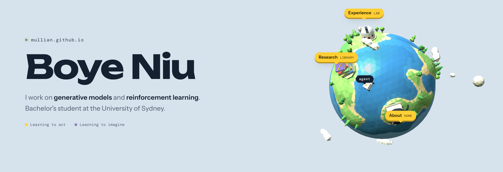

<a href="https://mul1ian.github.io">
  <picture>
    <source media="(prefers-color-scheme: dark)" srcset="assets/banner-dark.png">
    
  </picture>
</a>

I'm an undergraduate student at the University of Sydney, majoring in mathematics and statistics, with an interest in post-training frontier AI models.

**Research interests:** generative models · reinforcement learning · post-training frontier AI models

### Selected publications

- **ICLR 2025** · [Flow: Modularized Agentic Workflow Automation](https://arxiv.org/abs/2501.07834) 
  **B. Niu**, Y. Song, K. Lian, Y. Shen, Y. Yao, K. Zhang, T. Liu
- **arXiv 2026** · [Exploring the Design Space of Reward Backpropagation for Flow Matching](https://arxiv.org/abs/2606.11075) 
  R. Wang\*, **B. Niu**\*, X. Zhou\*, Y. Huang, T. Liu, C. Zhang
- **arXiv 2026** · [When Diffusion Breaks Constraints: Sequential Autoregressive Generation with RL and MCTS](https://arxiv.org/abs/2512.01242) 
  Z. Zhao, **B. Niu**\*, H. Soh, D. Hsu, W. S. Lee

\* equal contribution

### Also contributed to

[ERNIE 4.5](https://github.com/PaddlePaddle/ERNIE) · [AgentCPM-Explore](https://github.com/OpenBMB/AgentCPM) · [MassGen](https://github.com/massgen/MassGen)

---

[Homepage](https://mul1ian.github.io) · [Google Scholar](https://scholar.google.com/citations?user=YaBVaU8AAAAJ) · [LinkedIn](https://www.linkedin.com/in/boye-niu/) · boyeniu@gmail.com
